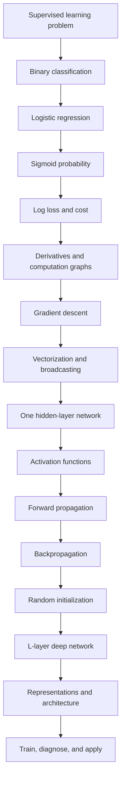
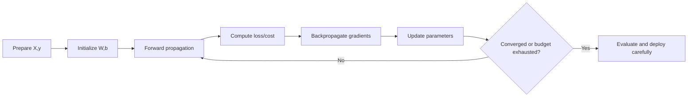

# Neural Networks and Deep Learning — Knowledge Guide

> A concept-first study guide synthesized from the supplied course folder and verified against official DeepLearning.AI and Coursera course information. Raw media filenames, ``index.mp4``, ``subtitle.txt``, and ``subtitles-vi.vtt`` are intentionally excluded.

## 1. Course identity and outcomes

This is Course 1 of the Deep Learning Specialization: **Neural Networks and Deep Learning**. The official course description presents four modules: Introduction to Deep Learning, Neural Networks Basics, Shallow Neural Networks, and Deep Neural Networks. The stated outcomes are to build, train, and apply fully connected networks; implement vectorized networks; identify architecture parameters; and apply deep learning to practical problems.

| Course fact | Details |
|---|---|
| Level | Intermediate |
| Structure | 4 modules/weeks |
| Official duration | About 3 weeks at roughly 10 hours/week on Coursera; the DeepLearning.AI catalog lists about 24h32m of video/course material |
| Main implementation language | Python with NumPy-style vectorization |
| Central model family | Fully connected feed-forward neural networks |
| Prerequisites | Basic Python, algebra, vectors/matrices, dot products, matrix multiplication, and basic derivatives are helpful; advanced calculus is not required for the course flow |

## 2. Complete course map



## 3. Module 1 — Introduction to Deep Learning

### Core ideas
- **Supervised learning:** learn a mapping from inputs ``x`` to targets ``y`` using labeled examples.
- **Neural network:** a parameterized function built by composing affine transformations and nonlinear activations.
- **Deep learning:** uses multiple learned layers so later layers can construct increasingly abstract representations.
- **Why it accelerated:** more labeled data, faster processors/GPUs, improved algorithms, and scalable software made larger networks practical.
- **Applications:** speech recognition, image recognition, recommendation, machine translation, search, and other high-dimensional prediction tasks.

### Learning objective
Be able to recognize when a neural network is an appropriate supervised-learning model and explain why depth and representation learning can outperform hand-designed features.

## 4. Module 2 — Neural Network Basics

### 4.1 Binary classification
A binary classifier predicts one of two labels, conventionally ``y in {0,1}``. Examples include spam/not-spam, disease/no disease, and object absent/object present. Each example has an input vector ``x`` and target ``y``.

### 4.2 Logistic regression as the smallest neural-network building block
1. Compute a linear score: ``z = w^T x + b``.
2. Convert the score to a number in ``(0,1)``: ``a = sigma(z)``.
3. Interpret ``a`` as the estimated probability of class 1.
4. Apply a decision threshold, often 0.5, only when a hard class prediction is needed.

The sigmoid is ``sigma(z)=1/(1+e^(-z))``. A large positive ``z`` approaches 1; a large negative ``z`` approaches 0; ``z=0`` gives 0.5.

### 4.3 Loss and cost
- Per-example binary cross-entropy: ``L(a,y)=-[y log(a)+(1-y)log(1-a)]``.
- Dataset cost: ``J(w,b)=(1/m) sum_i L(a^(i),y^(i))``.
- Confident correct predictions receive small loss; confident wrong predictions receive a very large loss.
- The logarithmic form is chosen because it produces a useful optimization objective and corresponds to maximum-likelihood estimation for Bernoulli labels.

### 4.4 Derivatives, computation graphs, and gradient descent
A computation graph breaks a function into local operations. The chain rule combines local derivatives so the model can compute how each parameter affects the final cost.

Gradient descent repeatedly applies ``theta := theta - alpha * dJ/dtheta``. Here ``theta`` represents ``w`` and ``b``, ``alpha`` is the learning rate, and the gradient points toward increasing cost, so subtraction moves toward lower cost.

### 4.5 Vectorization
For ``m`` examples, arrange inputs in a matrix ``X`` and compute predictions together. Vectorization replaces slow explicit loops with optimized array operations, reduces implementation inconsistency, and makes the same mathematics scale to neural-network layers.

Important implementation rules:
- Decide and document whether examples are columns or rows; this course commonly uses examples as columns.
- Check dimensions before debugging values.
- Use broadcasting deliberately; verify that arrays have the intended shape.
- Avoid accidental rank-1 vectors when a column vector is required.

## 5. Module 3 — Shallow Neural Networks

### 5.1 Representation
A one-hidden-layer network contains an input layer, one hidden layer, and an output layer. A hidden unit computes an affine function followed by an activation:

``z^[1] = W^[1]x + b^[1]``

``a^[1] = g^[1](z^[1])``

``z^[2] = W^[2]a^[1] + b^[2]``

``a^[2] = g^[2](z^[2])``

The superscript identifies the layer; the subscript identifies a unit or component. Parameters are weights and biases. Activations are intermediate representations, not labels.

### 5.2 Activation functions
| Function | Expression | Strengths / cautions |
|---|---|---|
| Sigmoid | ``1/(1+e^-z)`` | Useful for binary output; can saturate in hidden layers |
| Tanh | ``(e^z-e^-z)/(e^z+e^-z)`` | Zero-centered; can still saturate |
| ReLU | ``max(0,z)`` | Efficient and commonly used; zero gradient for negative inputs |
| Leaky ReLU | ``max(alpha z,z)`` | Keeps a small negative-side gradient |

Hidden layers need nonlinear activations. Without nonlinearity, a stack of affine transformations collapses to a single affine transformation and does not gain expressive power from depth.

### 5.3 Forward propagation
Forward propagation evaluates the network from input to output, caching intermediate ``z`` and ``a`` values because backpropagation needs them.

### 5.4 Backpropagation
Backpropagation applies the chain rule in reverse order. It starts with the output error, propagates sensitivities backward through the output activation and hidden layers, and produces gradients for every ``W^[l]`` and ``b^[l]``. It is not a separate learning objective; it is an efficient gradient-computation procedure.

### 5.5 Random initialization
Do not initialize all weights to zero in a multi-unit hidden layer: identical units receive identical gradients and remain identical. Small random weights break symmetry. Biases can commonly start at zero, while weight scale should avoid activations that are all saturated or numerically unstable.

## 6. Module 4 — Deep Neural Networks

### 6.1 L-layer notation
For each layer ``l``:
- ``z^[l] = W^[l] a^[l-1] + b^[l]``
- ``a^[l] = g^[l](z^[l])``
- ``a^[0] = x``
- The final output ``a^[L]`` is the model prediction.

For ``m`` examples, use matrix operations so all examples pass through a layer together. If layer ``l`` has ``n^[l]`` units and the previous layer has ``n^[l-1]`` units, then ``W^[l]`` has shape ``(n^[l], n^[l-1])`` and ``b^[l]`` has shape ``(n^[l],1)``.

### 6.2 Why deep representations matter
A deep network can learn a hierarchy: early layers may detect simple patterns, middle layers may combine them, and later layers may represent task-specific concepts. The exact representation depends on the data, architecture, objective, and training process; the layers are not guaranteed to correspond to human-named concepts.

### 6.3 Training loop


### 6.4 Parameters versus hyperparameters
| Type | Examples | How selected |
|---|---|---|
| Parameters | ``W``, ``b`` | Learned from training data by optimization |
| Hyperparameters | Learning rate, layer count, units/layer, activation, initialization, iteration count | Chosen by the practitioner and validated experimentally |

## 7. End-to-end implementation checklist

1. Define the prediction task and label semantics.
2. Partition data into training, development/validation, and test sets when evaluating generalization.
3. Normalize or otherwise prepare features consistently.
4. Establish tensor conventions and write down every expected matrix shape.
5. Implement a simple baseline.
6. Implement forward propagation and verify one example by hand.
7. Implement the loss and check extreme predictions.
8. Implement backpropagation; use gradient checking when appropriate.
9. Train with a reasonable learning rate and monitor cost.
10. Compare training and validation behavior before changing architecture.
11. Tune hyperparameters systematically and keep reproducible experiments.
12. Evaluate on the test set only after decisions are finalized.

## 8. Common failure modes and diagnosis

| Symptom | Likely cause | Diagnostic action |
|---|---|---|
| Cost diverges | Learning rate too large, unstable values, wrong gradient sign | Lower learning rate; inspect gradients and numerical ranges |
| Cost decreases extremely slowly | Learning rate too small or poorly scaled features | Normalize inputs and test learning rates |
| Hidden units learn the same thing | Symmetry from zero initialization | Randomize weights |
| Shape errors | Inconsistent row/column convention or broadcasting | Print expected and actual dimensions layer by layer |
| Training performance is poor | Underfitting, optimization issue, bad features, or implementation bug | Compare baseline, loss curve, and gradient checks |
| Training is strong but validation is weak | Overfitting or distribution mismatch | Inspect splits and use regularization/data/model changes in later courses |

## 9. What this course does and does not cover

This course establishes fully connected networks, logistic regression, vectorization, activations, forward propagation, backpropagation, deep-network notation, and basic architecture decisions. It is not a complete treatment of convolutional networks, sequence models, transformers, modern optimizers, batch normalization, dropout, or production MLOps; those topics appear later in the specialization or other courses.

## 10. Recommended mastery projects

- Derive and implement logistic regression from scalar operations, then vectorize it.
- Build a one-hidden-layer classifier for a nonlinearly separable toy dataset.
- Implement a two- or three-layer network with explicit shape assertions.
- Compare sigmoid, tanh, and ReLU in hidden layers.
- Plot the cost curve and test the effect of several learning rates.
- Add gradient checking to a small network and compare analytical and numerical gradients.
- Write a one-page model card describing data, task, metrics, failure cases, and limitations.

## 11. External authoritative sources

- [DeepLearning.AI — Neural Networks and Deep Learning](https://www.deeplearning.ai/courses/neural-networks-deep-learning) — official course overview, lesson count, and course outline.
- [Coursera — Neural Networks and Deep Learning](https://www.coursera.org/learn/neural-networks-deep-learning) — official module descriptions, outcomes, videos, readings, quizzes, and programming assignments.
- [DeepLearning.AI — Deep Learning Specialization](https://www.deeplearning.ai/specializations/deep-learning) — specialization context and progression beyond Course 1.
- [DeepLearning.AI Resources](https://www.deeplearning.ai/resources) — supplementary notes on initialization and parameter optimization.

## 12. Revision note

Raw archive inventory and transcript dumps were removed from this edition so the document focuses on durable course knowledge, conceptual relationships, formulas, implementation guidance, and externally verified course structure.

## 13. Python coding examples

The examples below use NumPy so that the mathematical operations remain visible. They are intentionally educational rather than production-ready. In real projects, use tested frameworks such as PyTorch or TensorFlow after understanding the underlying operations.

### 13.1 Setup and reproducibility

```python
import numpy as np

rng = np.random.default_rng(42)
```

**Why:** A fixed random seed makes experiments reproducible. If the result changes every run, it becomes difficult to determine whether a code change actually improved the model.

### 13.2 Sigmoid and binary cross-entropy

```python
def sigmoid(z):
    # Clip only for numerical safety when computing exp.
    z = np.clip(z, -500, 500)
    return 1.0 / (1.0 + np.exp(-z))


def binary_cross_entropy(y_hat, y):
    """Mean loss for y and predictions y_hat in [0, 1]."""
    eps = 1e-15
    y_hat = np.clip(y_hat, eps, 1 - eps)
    return -np.mean(y * np.log(y_hat) + (1 - y) * np.log(1 - y_hat))
```

**Why:** The sigmoid converts an unrestricted score into a probability-like value. Cross-entropy strongly penalizes confident wrong predictions and is the natural loss for binary labels.

### 13.3 Logistic regression from scratch

This is the basic building block for the later neural-network examples.

```python
def train_logistic_regression(X, y, learning_rate=0.1, steps=2000):
    """
    X shape: (m, n_features)
    y shape: (m,)
    """
    m, n_features = X.shape
    w = np.zeros(n_features)
    b = 0.0
    history = []

    for step in range(steps):
        z = X @ w + b                 # (m,)
        y_hat = sigmoid(z)             # (m,)

        # Derivatives of the average binary cross-entropy cost.
        dz = y_hat - y                # (m,)
        dw = (X.T @ dz) / m            # (n_features,)
        db = np.mean(dz)               # scalar

        w -= learning_rate * dw
        b -= learning_rate * db

        if step % 100 == 0:
            history.append(binary_cross_entropy(y_hat, y))

    return w, b, history


def predict_logistic(X, w, b, threshold=0.5):
    probabilities = sigmoid(X @ w + b)
    labels = (probabilities >= threshold).astype(int)
    return labels, probabilities
```

**Why this implementation matters:**

- ``X @ w + b`` is the linear score ``z``.
- ``y_hat - y`` is the simplified derivative for sigmoid plus binary cross-entropy.
- ``X.T @ dz`` computes all weight gradients at once; this is vectorization.
- ``learning_rate`` is a hyperparameter, while ``w`` and ``b`` are learned parameters.
- The threshold is separate from probability estimation, so it can be changed when false positives and false negatives have different costs.

Example:

```python
X = np.array([
    [0.0, 0.0],
    [0.0, 1.0],
    [1.0, 0.0],
    [1.0, 1.0],
])
y = np.array([0, 0, 0, 1])

w, b, losses = train_logistic_regression(X, y)
predictions, probabilities = predict_logistic(X, w, b)
print(predictions)
print(probabilities)
```

### 13.4 Vectorized forward propagation for one hidden layer

For this course convention, examples are columns: ``X`` has shape ``(n_x, m)``.

```python
def initialize_one_hidden_layer(n_x, n_h, n_y, seed=42):
    rng = np.random.default_rng(seed)
    return {
        "W1": 0.01 * rng.standard_normal((n_h, n_x)),
        "b1": np.zeros((n_h, 1)),
        "W2": 0.01 * rng.standard_normal((n_y, n_h)),
        "b2": np.zeros((n_y, 1)),
    }


def forward_one_hidden_layer(X, params):
    W1, b1 = params["W1"], params["b1"]
    W2, b2 = params["W2"], params["b2"]

    Z1 = W1 @ X + b1       # (n_h, m)
    A1 = np.tanh(Z1)       # nonlinear hidden representation
    Z2 = W2 @ A1 + b2      # (n_y, m)
    A2 = sigmoid(Z2)       # binary output

    cache = {"X": X, "Z1": Z1, "A1": A1, "Z2": Z2, "A2": A2}
    return A2, cache
```

**Why:** ``W1 @ X`` applies the same hidden-layer transformation to every example. The bias uses broadcasting across the ``m`` examples. The hidden ``tanh`` is essential: without a nonlinear activation, the two affine layers would collapse into one affine transformation.

### 13.5 Backpropagation for one hidden layer

```python
def backward_one_hidden_layer(params, cache, y):
    m = y.shape[1]
    W2 = params["W2"]
    X, A1, A2 = cache["X"], cache["A1"], cache["A2"]

    # For sigmoid output + binary cross-entropy:
    dZ2 = A2 - y                    # (n_y, m)
    dW2 = (dZ2 @ A1.T) / m          # (n_y, n_h)
    db2 = np.sum(dZ2, axis=1, keepdims=True) / m

    dA1 = W2.T @ dZ2                # (n_h, m)
    dZ1 = dA1 * (1 - A1**2)         # derivative of tanh
    dW1 = (dZ1 @ X.T) / m           # (n_h, n_x)
    db1 = np.sum(dZ1, axis=1, keepdims=True) / m

    return {"dW1": dW1, "db1": db1, "dW2": dW2, "db2": db2}
```

**Why:** Backpropagation applies the chain rule from the output toward the input. The cached activations are reused instead of recomputing them. Each gradient has the same shape as its parameter, which is a powerful debugging check.

### 13.6 Parameter update and training loop

```python
def update_parameters(params, grads, learning_rate):
    for name in ("W1", "b1", "W2", "b2"):
        params[name] -= learning_rate * grads["d" + name]
    return params


def train_one_hidden_layer(X, y, n_h=4, learning_rate=1.0, steps=5000):
    n_x = X.shape[0]
    n_y = y.shape[0]
    params = initialize_one_hidden_layer(n_x, n_h, n_y)
    history = []

    for step in range(steps):
        A2, cache = forward_one_hidden_layer(X, params)
        loss = binary_cross_entropy(A2, y)
        grads = backward_one_hidden_layer(params, cache, y)
        params = update_parameters(params, grads, learning_rate)

        if step % 500 == 0:
            history.append(loss)

    return params, history


def predict_one_hidden_layer(X, params, threshold=0.5):
    probabilities, _ = forward_one_hidden_layer(X, params)
    return (probabilities >= threshold).astype(int), probabilities
```

**Why:** Training is a repeated cycle of forward propagation, loss calculation, backward propagation, and parameter update. The loop should normally show decreasing loss; divergence usually indicates a learning-rate, shape, initialization, or gradient problem.

### 13.7 Matrix-dimension assertions

```python
def check_shapes(X, params):
    assert X.ndim == 2
    assert params["W1"].shape[1] == X.shape[0]
    assert params["b1"].shape == (params["W1"].shape[0], 1)
    assert params["W2"].shape[1] == params["W1"].shape[0]
    assert params["b2"].shape == (params["W2"].shape[0], 1)
```

**Why:** Many neural-network bugs are not mathematical errors; they are dimension errors hidden by broadcasting. Assertions make the intended architecture explicit and fail early.

### 13.8 Numerical gradient checking

A numerical derivative approximates the gradient using a small perturbation:

```python
def numerical_gradient(f, theta, epsilon=1e-7):
    grad = np.zeros_like(theta, dtype=float)
    for i in range(theta.size):
        original = theta.flat[i]
        theta.flat[i] = original + epsilon
        plus = f(theta)
        theta.flat[i] = original - epsilon
        minus = f(theta)
        theta.flat[i] = original
        grad.flat[i] = (plus - minus) / (2 * epsilon)
    return grad
```

**Why:** Compare numerical gradients with analytical backpropagation gradients while debugging a small network. Once the implementation is trusted, disable gradient checking because it is much slower than backpropagation.

### 13.9 Equivalent PyTorch training pattern

The course teaches the mechanics with NumPy. In practice, a framework automates much of the gradient bookkeeping:

```python
import torch
from torch import nn

model = nn.Sequential(
    nn.Linear(2, 4),
    nn.Tanh(),
    nn.Linear(4, 1),
)

loss_fn = nn.BCEWithLogitsLoss()  # combines sigmoid and binary cross-entropy
optimizer = torch.optim.SGD(model.parameters(), lr=0.1)

X_t = torch.tensor(X, dtype=torch.float32)
y_t = torch.tensor(y.reshape(-1, 1), dtype=torch.float32)

for _ in range(1000):
    logits = model(X_t)
    loss = loss_fn(logits, y_t)

    optimizer.zero_grad()
    loss.backward()
    optimizer.step()
```

**Why use ``BCEWithLogitsLoss``:** It combines the sigmoid and binary cross-entropy in a numerically stable implementation. Frameworks still perform the same conceptual steps: forward pass, loss, gradient computation, and parameter update.

### 13.10 Code-to-concept map

| Code | Course concept | Question to ask while learning | 
|---|---|---|
| ``X @ w + b`` | Linear model | Are the shapes correct? | 
| ``sigmoid(z)`` | Activation/output probability | Is this a probability or a hard class? | 
| ``y_hat - y`` | Output gradient | Why does this simplify for sigmoid + cross-entropy? | 
| ``X.T @ dz`` | Vectorized gradient | Does the result match ``w`` shape? | 
| ``W @ A_prev + b`` | Layer forward propagation | Which layer does each matrix belong to? | 
| ``dA * g'(Z)`` | Chain rule | Which cached activation is needed? | 
| ``parameter -= lr * gradient`` | Gradient descent | Is the loss decreasing? | 
| Random ``W`` initialization | Symmetry breaking | Would identical hidden units learn different features? | 

## 14. Code limitations and next steps

These examples omit production concerns such as minibatches, regularization, early stopping, checkpointing, data pipelines, experiment tracking, mixed precision, and deployment. They are deliberately small enough to inspect line by line. After mastering them, reimplement the same model in PyTorch or TensorFlow and compare the framework gradients with the NumPy gradients.

## 15. Complete runnable project — XOR classification

**Level:** Practice. **Goal:** show why a nonlinear hidden layer is needed. XOR is not linearly separable, so logistic regression cannot solve it perfectly while a network with a nonlinear hidden layer can.

### Installation

```bash
python -m venv .venv
# Windows PowerShell: .\.venv\Scripts\Activate.ps1
# macOS/Linux: source .venv/bin/activate
pip install numpy matplotlib scikit-learn pytest
```

### Complete NumPy implementation

```python
import numpy as np
import matplotlib.pyplot as plt
from sklearn.metrics import accuracy_score, precision_score, recall_score, confusion_matrix

rng = np.random.default_rng(7)
X = np.array([[0., 0., 1., 1.], [0., 1., 0., 1.]])
y = np.array([[0., 1., 1., 0.]])

def sigmoid(z):
    z = np.clip(z, -500, 500)
    return 1 / (1 + np.exp(-z))

def init():
    return {"W1": .5*rng.standard_normal((4, 2)), "b1": np.zeros((4, 1)),
            "W2": .5*rng.standard_normal((1, 4)), "b2": np.zeros((1, 1))}

def forward(X, p):
    Z1 = p["W1"] @ X + p["b1"]
    A1 = np.tanh(Z1)
    Z2 = p["W2"] @ A1 + p["b2"]
    A2 = sigmoid(Z2)
    return A2, (X, A1, A2)

def loss(A, y):
    A = np.clip(A, 1e-12, 1-1e-12)
    return float(-np.mean(y*np.log(A) + (1-y)*np.log(1-A)))

def backward(p, cache, y):
    X, A1, A2 = cache
    m = X.shape[1]
    dZ2 = A2-y
    dW2 = dZ2 @ A1.T / m
    db2 = np.sum(dZ2, axis=1, keepdims=True) / m
    dZ1 = (p["W2"].T @ dZ2) * (1-A1**2)
    dW1 = dZ1 @ X.T / m
    db1 = np.sum(dZ1, axis=1, keepdims=True) / m
    return {"dW1": dW1, "db1": db1, "dW2": dW2, "db2": db2}

def train(X, y, steps=10000, lr=1.2):
    p, history = init(), []
    for step in range(steps):
        A, cache = forward(X, p)
        history.append(loss(A, y))
        g = backward(p, cache, y)
        for name in ("W1", "b1", "W2", "b2"):
            p[name] -= lr * g["d" + name]
    return p, history

p, history = train(X, y)
probabilities, _ = forward(X, p)
predictions = (probabilities >= .5).astype(int).ravel()
truth = y.astype(int).ravel()
print("Probabilities:", np.round(probabilities.ravel(), 3))
print("Accuracy:", accuracy_score(truth, predictions))
print("Precision:", precision_score(truth, predictions, zero_division=0))
print("Recall:", recall_score(truth, predictions, zero_division=0))
print("Confusion matrix:\n", confusion_matrix(truth, predictions))
plt.plot(history); plt.xlabel("step"); plt.ylabel("binary cross-entropy")
plt.title("XOR training loss"); plt.grid(); plt.show()
```

**Why it works:** ``W @ X + b`` is the affine transformation; ``tanh`` creates a nonlinear hidden representation; the sigmoid produces an output probability; backpropagation computes gradients; and gradient descent updates every parameter. The four-example dataset is for learning only and cannot demonstrate real-world generalization.

## 16. Evaluation and experiments

### Train/validation/test discipline

```python
from sklearn.model_selection import train_test_split
from sklearn.preprocessing import StandardScaler

X_train, X_temp, y_train, y_temp = train_test_split(
    X, y.ravel(), test_size=.30, random_state=42, stratify=y.ravel())
X_valid, X_test, y_valid, y_test = train_test_split(
    X_temp, y_temp, test_size=.50, random_state=42, stratify=y_temp)
scaler = StandardScaler()
X_train = scaler.fit_transform(X_train)
X_valid = scaler.transform(X_valid)
X_test = scaler.transform(X_test)
```

Fit preprocessing only on training data. Use validation data for architecture and hyperparameter decisions. Keep the test set untouched until the final report; otherwise evaluation leaks information.

### Metrics

- **Accuracy:** overall fraction correct.
- **Precision:** fraction of predicted positives that are correct.
- **Recall:** fraction of actual positives detected.
- **F1:** balance of precision and recall.
- **Confusion matrix:** counts TP, FP, TN, and FN.
- **Cross-entropy:** evaluates the quality of probabilities, not just thresholded classes.

Run experiments with learning rates such as ``.01``, ``.1``, ``1.0``, and ``2.0``. A small rate learns slowly; a suitable rate decreases smoothly; an excessive rate oscillates or diverges. Compare logistic regression, one hidden layer, and a deeper model: XOR should expose the limitation of a linear decision boundary.

## 17. Debugging laboratory

1. Change ``-= learning_rate * gradient`` to ``+=``. Expected symptom: loss rises.
2. Initialize all weights to zero. Expected symptom: hidden units remain identical because symmetry is not broken.
3. Set ``learning_rate=100``. Expected symptom: unstable or exploding loss.
4. Remove ``keepdims=True`` from bias gradients. Expected symptom: unintended broadcasting and wrong shapes.
5. Replace the tanh derivative ``1-A1**2`` with an incorrect expression. Expected symptom: training fails despite valid dimensions.
6. Fit a scaler on all data. Expected issue: validation/test information leaks into training.

Debug in this order: labels, shapes, numerical ranges, tiny-dataset overfitting, loss curve, then gradient checking.

## 18. Testing strategy

```python
def test_sigmoid_range():
    values = sigmoid(np.array([-100., 0., 100.]))
    assert np.all(values > 0) and np.all(values < 1)

def test_forward_shape():
    p = init()
    A, _ = forward(X, p)
    assert A.shape == y.shape

def test_parameter_shapes():
    p = init()
    assert p["W1"].shape == (4, 2)
    assert p["b1"].shape == (4, 1)
    assert p["W2"].shape == (1, 4)

def test_training_reduces_loss():
    p = init()
    before, _ = forward(X, p)
    trained, history = train(X, y, steps=3000)
    after, _ = forward(X, trained)
    assert loss(after, y) < loss(before, y)
```

Run with ``pytest -q``. Shape tests catch architecture errors; behavior tests catch incorrect gradients and updates.

## 19. Glossary

| Term | Meaning |
|---|---|
| Activation | Neuron output after its nonlinear function |
| Backpropagation | Chain-rule procedure for computing parameter gradients |
| Epoch | One pass through the training dataset |
| Logit | Pre-sigmoid score ``z`` |
| Loss | Error for a prediction or example |
| Cost | Aggregate loss over examples |
| Parameter | Learned weight or bias |
| Hyperparameter | Practitioner-selected training or architecture setting |
| Representation | Intermediate feature pattern learned by a layer |
| Saturation | Region where an activation gradient becomes very small |
| Symmetry breaking | Random initialization that lets hidden units learn different features |
| Vectorization | Array/matrix operations replacing explicit loops |

## 20. Mini model card

**Intended use:** educational binary-classification demonstration.

**Data:** four synthetic XOR examples; not representative production data.

**Model:** two inputs, one tanh hidden layer, one sigmoid output.

**Limitations:** results depend on initialization and learning rate; the toy dataset cannot establish generalization; threshold 0.5 is not universally optimal; no fairness, privacy, drift, missing-data, or deployment analysis is included.

**Responsible use:** never use this toy model for medical, financial, employment, safety, or other high-impact decisions. Real systems require representative validation, documented error costs, monitoring, and domain review.

## 21. Lesson-to-knowledge mapping

| Module | Main knowledge outcome | Priority |
|---|---|---|
| Week 1 — Introduction | Explain supervised learning, neural networks, and why deep learning became practical | Required |
| Week 2 — Basics | Implement logistic regression, loss, derivatives, gradient descent, vectorization, and broadcasting | Required |
| Week 3 — Shallow networks | Build a one-hidden-layer network with activations, forward propagation, backpropagation, and random initialization | Required |
| Week 4 — Deep networks | Generalize notation and propagation to L layers; reason about dimensions and hyperparameters | Required |
| Optional calculus/code exercises | Strengthen derivatives, computation graphs, NumPy, and gradient debugging | Advanced |

## 22. Updated completeness assessment

The guide now includes conceptual coverage, formulas, diagrams, source mapping, runnable NumPy code, a complete XOR project, PyTorch context, evaluation metrics, visualization, model comparison, debugging exercises, unit tests, installation instructions, a glossary, and a model card. Convolutional networks, sequence models, transformers, advanced optimization, regularization, and production deployment remain later-course topics.
