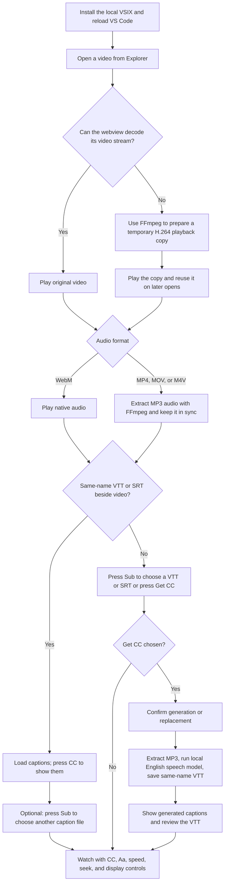

# vscode-video-player

Play `.mp4`, `.mov`, `.m4v`, and `.webm` files inside VS Code with sound and sidecar subtitles. This local build adds a subtitle picker, English caption generation, automatic picture enhancement, and a playback copy for video codecs the VS Code webview cannot decode.

## Install

Use VS Code 1.90 or newer. From the root of this repository, run:

```powershell
python tools/install_video_player.py
```

This command needs Python, the VS Code `code` command, and `tools/vscode-video-player.vsix`. It installs the local package, checks its version, and removes older player editions that claim the same default editor. Reload VS Code if it was already open.

To share the extension, send `tools/vscode-video-player.vsix`. The recipient can install it with:

```powershell
code --install-extension vscode-video-player.vsix
```

The packaged Windows x64 build includes FFmpeg, the speech runner, and the English speech model. It can play supported files and generate captions offline after installation. On macOS or Linux, MP4/MOV/M4V sound needs FFmpeg on `PATH` or its path set in `unmuteVideo.ffmpegPath`; **Get CC** is available only on Windows x64 in this package. WebM uses native audio and does not need FFmpeg.

## Workflow



The picture filter adds mild sharpening and small brightness, contrast, and color adjustments during playback. It is on by default. The original video and subtitle files are unchanged by playback and by the temporary H.264 copy.

### Open and control a video

Open a supported video from VS Code Explorer. The extension registers as its default editor. You can also use **Open with vscode-video-player** from the Command Palette. Click the picture or press `Space`/`K` to play or pause. Hover over the timeline to preview the frame and time without moving playback; click or drag it to seek. Use `J`/`L` and left/right arrows to seek by the configured step, which defaults to 10 seconds. Press `M` to mute, `F` to toggle VS Code's Zen Mode full screen view, or `P` for picture in picture when supported. Press `F` again or `Esc` twice to leave Zen Mode. Use the speed button to cycle playback speeds.

For MP4/MOV/M4V, the extension extracts audio to a temporary MP3 and synchronizes it with the muted video. If the webview cannot decode the video stream, it makes a temporary H.264 playback copy. The first open can take longer; later opens can reuse the cached copy. The video cache is limited to 512 MB and old copies are pruned. These operations need FFmpeg and a trusted workspace. In an untrusted workspace, the extension shows a trust action and keeps extracted audio disabled until trust is granted.

### Use existing captions

Put the subtitle file beside the video with the **same base name**. The player checks `.vtt` first, then `.srt`:

```text
lesson.mp4       lesson.vtt       lesson-vi.vtt
index (1).mp4    index (1).vtt    index (1)-vi.vtt
```

The matching English file loads when the video opens. Press **CC** to show or hide loaded captions. Press **Sub** to choose any `.vtt` or `.srt` file, including a `-vi.vtt` file for Vietnamese; the picker starts in the video's folder and displays the selection immediately. Press **Aa** to adjust caption size, font, color, or background. If **CC** is unavailable, no caption file has been loaded yet: select one with **Sub** or generate one with **Get CC**.

### Generate English captions

Press **Get CC** while the video is open in a trusted workspace. A confirmation dialog explains that speech recognition may take several minutes and may mishear words. If a matching English `.vtt` already exists, the dialog asks whether to replace it. Canceling leaves the file unchanged.

After confirmation, the extension extracts MP3 audio, runs its local English speech model, checks the timed result, and saves `<video-base-name>.vtt` beside the video. The generated captions appear immediately. Review and correct the VTT in VS Code, especially names and technical terms. **Get CC** creates English captions only; it does not translate them into Vietnamese. The video must be in a writable folder for the VTT to be saved.

## Requirements and limits

- This player needs a real on-disk video path. Virtual and web workspaces are unsupported.
- In Remote-SSH, WSL, or Codespaces, the extension host runs remotely, so the video and FFmpeg must be available there. The bundled Windows x64 speech runner does not run on other platforms.
- If FFmpeg is missing, WebM can still play with native audio. MP4/MOV/M4V may play without extracted sound, and **Get CC** cannot extract audio.
- Generated captions are automatic speech recognition output and need human review.

## Build the local package

After changing the extension source, rebuild the VSIX from the repository root, then reinstall it:

```powershell
python tools/build_local_vsix.py
python tools/install_video_player.py
```

The build script expects local FFmpeg and the verified English model; see the script for its exact inputs. This repository's extension is based on [vscode-unmute-video](https://github.com/yutabee/vscode-unmute-video) and retains its MIT license; see [LICENSE.md](LICENSE.md) and [SECURITY.md](SECURITY.md).
